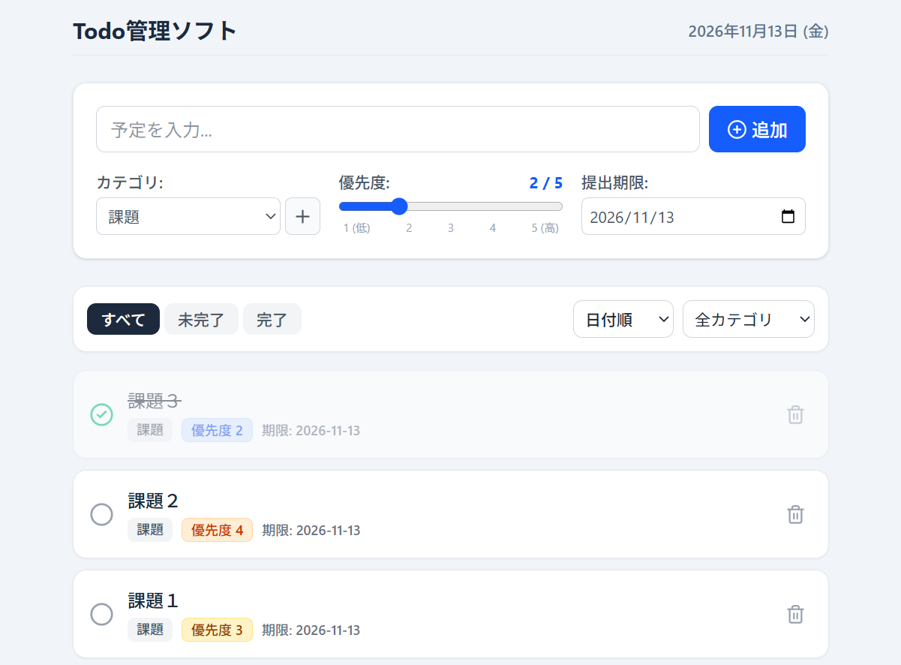
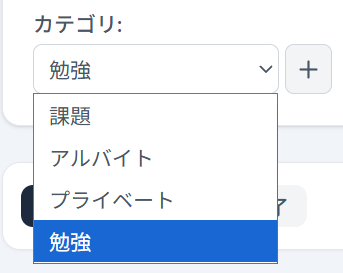
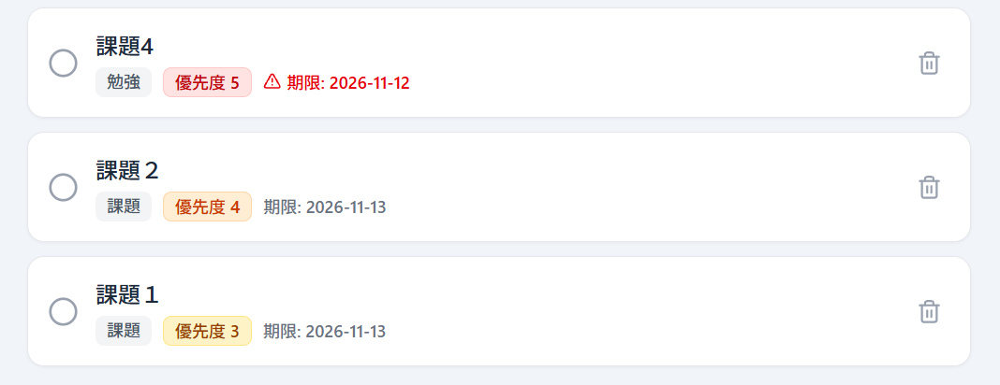
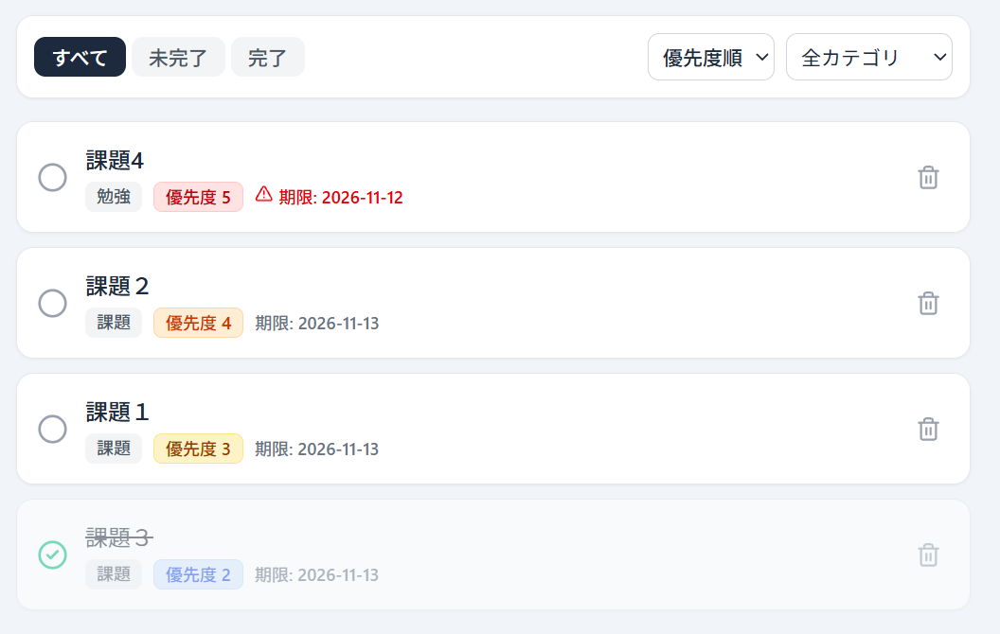
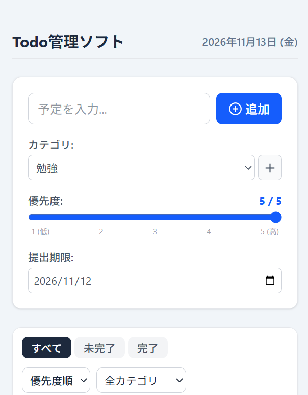

# Todo管理ソフト

デプロイURL: https://dddd145.github.io/todo-app/

## 開発の背景・コンセプト
実験レポートやプログラミング課題の提出、アルバイトのシフトなど、日々やることが重なって「結局どれから手をつけるべきか」が分かりにくくなることがよくありました。

市販のTodoアプリやメモ帳では、カテゴリがあらかじめ固定されていて後から増やしづらかったり、優先度ごとに並び替えて直感的に確認しにくかったりする不満がありました。そこで、**「自分の生活に合わせてカテゴリをその場で追加できること」「スライダーで5段階の優先度を直感的に決められること」「期限切れを自動で警告してくれること」**を軸に、自分専用のタスク管理アプリを作成しました。

## 画面イメージ

| メイン画面 | タスクの追加・カテゴリ作成 |
| :---: | :---: |
|  |  |

| 期限切れの警告表示 | 絞り込み・並び替え | スマホ画面での表示 |
| :---: | :---: | :---: |
|  |  |  |

## 主な機能
- **予定の追加・完了・削除**
  - 誤操作で予定を消してしまうのを防ぐため、削除ボタンを押したときに確認ダイアログを表示します。
- **カテゴリの選択と新規追加**
  - 初期状態の「課題」「アルバイト」「プライベート」に加えて、「＋」ボタンから自分の好きなカテゴリを新しく作成できます。
- **スライダーによる5段階の優先度設定**
  - 1〜5の均等目盛りスライダーで優先度を設定でき、一覧では優先度ごとに色分けされたバッジ（1が緑、5が赤）で一目で重要度が分かります。
- **期限切れの自動チェック**
  - `dayjs` を使って今日の日付と提出期限を比較し、期限を過ぎている未完了の予定は赤文字と警告アイコンで強調表示します。
- **柔軟な絞り込みと並び替え**
  - 「すべて / 未完了 / 完了」の状態別や、作成したカテゴリごとの絞り込みができます。
  - 並び替えは通常の「日付順」のほか、「優先度順」に切り替え可能です。
- **データの永続化（LocalStorage）**
  - 登録した予定と追加したカテゴリはブラウザの LocalStorage に保存されるため、リロードしてもデータが消えません。

## 使用技術
- React 18 / TypeScript
- Vite
- Tailwind CSS v4
- dayjs
- GitHub Actions / GitHub Pages

## 工夫した点・苦労した点
- **優先度順ソートのロジック**
  - 単に優先度の数字が高い順（5→1）に並べるだけでなく、同じ優先度のタスク同士は「提出期限が近い順」に並ぶように `.sort()` の比較条件を工夫しました。
- **カテゴリの動的追加と保存**
  - 最初はカテゴリを固定の型で定義していましたが、後から自由に増やせるように配列の state に変更し、タスク本体とは別キーで LocalStorage に保存する仕組みにしました。
- **GitHub Pages へのビルド・デプロイ調整**
  - Vite でビルドした際にパスがずれて公開画面が真っ白になる問題が起きましたが、`vite.config.ts` の `base` パス指定と TypeScript の型インポート（`import type`）を見直すことで解決しました。

---

開発期間: 2026.10.28 ~ 2026.11.13 (約18時間)
